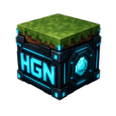

<div align="center">



# HGN Minecraft Client

The public client layer of the HorizonGate Network, installed and updated by
the separately maintained HGN Launcher.

</div>

---

## What it does

- **HGN main menu** — the title screen rebuilt in the HGN dark and cyan
  theme, with a direct **Play HorizonGate Network** button.
- **Official servers pinned** — the Hub and VinkSMP are kept at the top of the
  multiplayer list and cannot drift out of it.
- **Responsive client settings** — the dashboard exposes HGN HUD scale, motion,
  particles, contrast, render quality, and container controls while
  preserving normal Minecraft options.
- **Polished gameplay surfaces** — compact race HUDs, synchronized real-item
  hotbar, held-item formatting, Dragon Eye, containers, loading, cosmetics, and
  authenticated 3D previews share one bounded HGN rendering system.
- **Network channels** — carries the `hgn:core` and `hgn:vinksmp` plugin-message
  channels the network's plugins talk over, and announces itself on join so the
  server knows the player is running the HGN client.

It is a client layer, not a mod players manage: the launcher installs it and it
is hidden from the content list.

The reference redesign adds dedicated creative inventory, furnace, enchanting,
and villager-trading surfaces. Every survival inventory retains three rows of
nine slots plus the nine-slot hotbar, even where the supplied artwork omits a
row. Creative keeps its native 45-slot picker, inventory tab, and saved hotbars.
The Containers setting can disable the new layouts after the initial upgrade.

## Supported versions

The new Smart Mob voice/FX work is a **1.8.21 source candidate**, not part of
the immutable `ALPHA-V1.8.20` jars. It receives only the exact optional
`hgn:boss_voice` and `hgn:boss_fx` UTF-8 JSON version-1 payloads, renders
bounded client-side effects, and generates local Windows speech when SAPI is
available. There is no Eclipse/OpenAI credential or direct API call in the
client. Speech failure leaves subtitles plus a normal Minecraft sound. For an
offline local protocol demonstration in a world, use `/hgn bossdemo skeleton`,
`/hgn bossdemo titan`, and `/hgn bossdemo fx`; these send nothing to a server.
The 1.8.21 candidate is not a public download until its exact 1.21.4 Fabric,
Forge, and NeoForge jars and matching launcher pass release verification.

The older **Alpha 1.8.15** full-matrix test release publishes **35 client builds** for
**Minecraft 1.21 through 1.21.11**. Fabric and NeoForge cover all twelve
versions; Forge covers eleven because no Forge 1.21.2 target is available.
The `1.8.17-alpha.1` / `ALPHA-V1.8.17` source candidate carries the default-off
experimental HGN hotbar from the earlier 1.8.16 candidate. It has no matching
immutable client build set yet. Its full 35-target build matrix and in-world
visual acceptance are still pending; the published 1.8.15 release remains the
current test download.
The completed visual-remake Beta has not been published.

| Minecraft | Current status |
| --- | --- |
| 1.21 – 1.21.1 | Fabric, Forge, and NeoForge verified |
| 1.21.2 | Fabric and NeoForge verified; Forge unavailable |
| 1.21.3 – 1.21.11 | Fabric, Forge, and NeoForge verified |

Each published manifest must contain exactly **35 unique builds** with exact
sizes and SHA-256 identities; a missing, duplicate, or unexpected target fails
collection before publication.

Minecraft **26.x is not supported yet**: Mojang stopped publishing mappings at
26.1, and the current modding toolchain has no path for an already-deobfuscated
game. The matrix entries are in place for when it does.

Requires **Java 21**. Fabric builds bundle the Fabric API modules used by HGN;
other mods may ship their own modules or require additional ones. The launcher
installs dependencies declared by each catalogue release, but does not claim
that every third-party mod has declared all of its requirements.

## Building

```bash
./gradlew :fabric:build   -Pmc=1.21.4
./gradlew :forge:build    -Pmc=1.21.4
./gradlew :neoforge:build -Pmc=1.21.4
```

Use `-Pmc=<version>` for each supported version. Release publication requires
all 35 targets listed above rather than accepting a partial loader set.

Each build runs the container geometry checks. A development-only startup check
forces the container classes through the loader's mixin transformations and
then exits automatically, without capturing screenshots:

```bash
./gradlew :fabric:runClient -Pmc=1.21.4 -Ploader=fabric -Pdevscreen=container-smoke
```

Success requires `HGN_CONTAINER_SMOKE_OK` in the client log, not merely a zero
process exit code. Visual feedback is provided manually by the owner.

Publish the built jars for the launcher to download:

```bash
node tools/collect-builds.mjs <path-to-hgn-client-builds>
```

The collector creates an immutable
`releases/<release-name>/manifest.json` plus `jars/` tree. An identical rerun is
safe, but any attempt to change an existing release directory fails. Older
root-level manifests/jars remain untouched for launchers published before this
release-scoped contract.

## Layout

| Path | Contents |
| --- | --- |
| `common/src/main` | Most of the client: screens, config, servers, networking, mixins |
| `common/src/compat/<gen>` | The only version-specific sources — see below |
| `fabric/`, `forge/`, `neoforge/` | Loader entry point and mod metadata |

Minecraft's client API changes shape between releases, so the verified matrix is
split into five generations. Each generation contains its compatible HUD,
cosmetic preview, cape/player-layer, item, and queued-rendering bridge.

| Generation | Versions | What differs |
| --- | --- | --- |
| `g1210` | 1.21 – 1.21.1 | PoseStack GUI; blit takes the texture directly |
| `g1212` | 1.21.2 – 1.21.5 | blit takes a render type first |
| `g1216` | 1.21.6 – 1.21.8 | Matrix3x2fStack GUI; blit takes a render pipeline |
| `g1219` | 1.21.9 – 1.21.10 | Player-skin lookup and related client API changes |
| `g12111` | 1.21.11 | ~580 classes renamed; different button draw hook |
